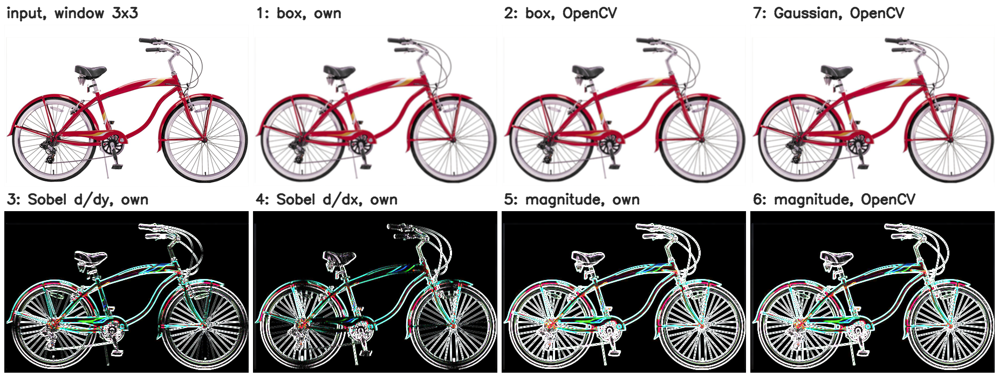
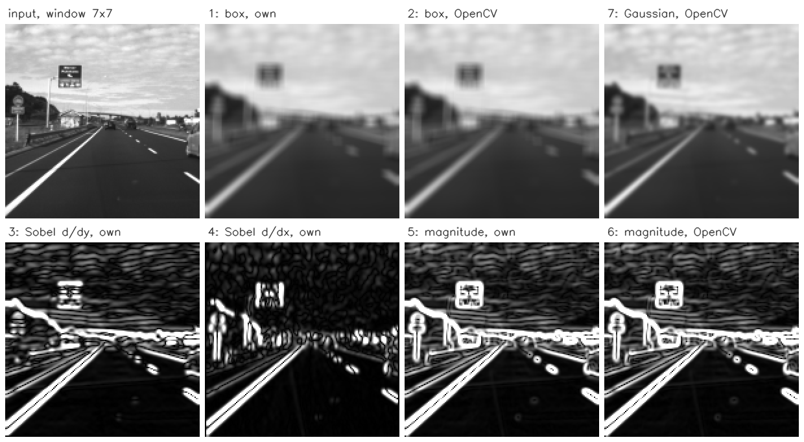
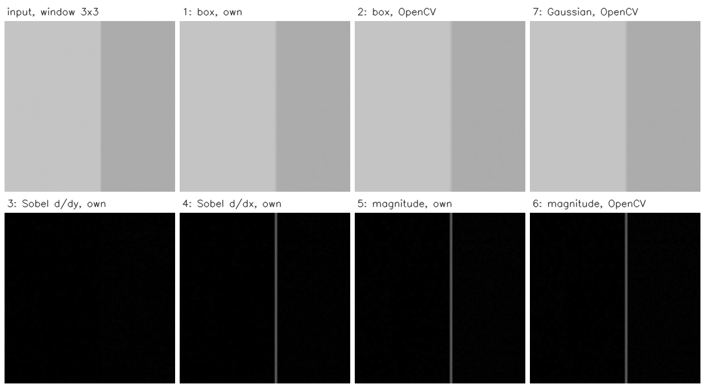

# Box, Sobel and Gaussian filters in C++

A C++/OpenCV program that applies seven image filters: a box filter, Sobel derivatives along x and y and the Sobel gradient magnitude, all written from scratch, next to OpenCV's `cv::boxFilter`, `cv::Sobel` with `cv::magnitude`, and `cv::GaussianBlur`, so that each hand-written filter can be compared with the library's. The window size can be 3, 5 or 7.

Michael Perez wrote it for Assignment 2 of CAP 4410 Computer Vision, Florida Polytechnic University, fall 2019. In 2026 its bugs were fixed, and it was split into a small library and a command-line program with a headless mode, tests and CI.

## Results

Output of `./build/filters --no-gui bicycle.bmp` (3×3 windows), the grid it writes as `output/bicycle_3x3_grid.png`. The top row holds the input and the smoothing filters, the bottom row the Sobel filters; the numbers are the keys that apply each filter in the interactive program.



The same with 7×7 windows on `south_L-150x150.png` (`--size 7`); 150×150 images are enlarged twice:



The step edge in `edge_L-150x150.png`, where the image gets darker by 24 grey levels from left to right, is found by key 4 (d/dx) and keys 5 and 6. The 2019 code missed it at 3×3 because it threw away negative derivatives:



How closely the filters written from scratch match OpenCV: the largest differences over the four sample images, as printed by the tests. 78 random images, from 1×1 to 301×203 pixels with 1, 3 and 4 channels, give no larger ones.

| Comparison | 3×3 | 5×5 | 7×7 |
| --- | :---: | :---: | :---: |
| Box filter, key 1 vs `cv::boxFilter` (key 2), grey levels | 0 | 0 | 0 |
| Derivatives along x and y vs `cv::Sobel` (`CV_64F`) | 0 | 0 | 0 |
| Gradient magnitude vs `cv::magnitude` | 2·10⁻¹³ | 4·10⁻¹² | 3·10⁻¹¹ |
| Displayed magnitude, key 5 vs key 6, grey levels | 0 | 1 (70 values) | 1 (30 values) |

The derivatives are sums of integers, so both implementations get them exactly. The magnitudes differ in the last digit because the OpenCV build used here (4.11 from conda-forge) computes `cv::magnitude` with Intel IPP, which does not always round the square root exactly; with IPP turned off they are identical. Where a scaled magnitude is exactly half-way between two integers (a 5×5 magnitude of 18 is shown as 18/12 = 1.5), that last digit decides the rounding, so keys 5 and 6 differ by one grey level at 70 (5×5) and 30 (7×7) of the 986,730 colour values of the four images, and nowhere else.

## The filters

| Key | Filter | Implementation |
| :---: | --- | --- |
| 1 | Box filter: the mean of the window | own |
| 2 | Box filter | `cv::boxFilter` |
| 3 | Sobel derivative along y, which finds horizontal edges | own |
| 4 | Sobel derivative along x, which finds vertical edges | own |
| 5 | Sobel gradient magnitude, √(gx² + gy²) | own |
| 6 | Sobel gradient magnitude | `cv::Sobel` and `cv::magnitude` |
| 7 | Gaussian blur with σ = 0, for which OpenCV uses the fixed kernels (1 2 1)/4, (1 4 6 4 1)/16 and (2 7 14 18 14 7 2)/64 | `cv::GaussianBlur` |

OpenCV's documentation says that when σ is 0 it is computed from the window size, which would give 0.8, 1.1 and 1.4 for 3, 5 and 7, but for these sizes OpenCV uses the fixed kernels of key 7 instead, whose standard deviations are 0.71, 1 and 1.37.

The 2019 report calls keys 3 and 4 the Sobel filters "towards x-axis edges" and "towards y-axis edges".

The own filters share one function, `ApplyKernel` in `filters.cpp`. It correlates each colour channel with an n×n kernel centred on the pixel, as `cv::filter2D` does, and keeps the signed result in double precision. Pixels outside the image are mirrored without repeating the edge pixel (`gfedcb|abcdefgh|gfedcba`, OpenCV's default border), so every pixel is filtered and images smaller than the window work too. The box filter rounds its result to the nearest integer.

The Sobel kernels are the outer product of a binomial smoothing kernel and a central-difference derivative kernel, the same ones `cv::getDerivKernels` returns:

| Size | Smoothing | Derivative |
| :---: | --- | --- |
| 3 | 1 2 1 | −1 0 1 |
| 5 | 1 4 6 4 1 | −1 −2 0 2 1 |
| 7 | 1 6 15 20 15 6 1 | −1 −4 −5 0 5 4 1 |

Keys 3 to 6 show, for each colour channel, the absolute value of the derivative or the magnitude. A step edge of h grey levels gives a derivative of 4h, 48h and 640h with the 3×3, 5×5 and 7×7 kernels, so the 5×5 and 7×7 results are divided by 12 and 160: every size then shows a step of h levels as 4h, clipped to 255, and the 3×3 result is the plain Sobel response. The same scaling is used for key 6, so keys 5 and 6 can be compared pixel by pixel.

## Building

Requirements: CMake 3.16 or later, a C++17 compiler, and OpenCV 4 with the core, imgproc, imgcodecs and highgui modules.

Ubuntu or Debian:

```sh
sudo apt-get install build-essential cmake libopencv-dev
cmake -S . -B build -DCMAKE_BUILD_TYPE=Release
cmake --build build
```

macOS with Homebrew:

```sh
brew install cmake opencv
cmake -S . -B build -DCMAKE_BUILD_TYPE=Release
cmake --build build
```

conda-forge (Linux or macOS, with the system compiler):

```sh
conda create -n filters -c conda-forge cmake make libopencv
conda activate filters
cmake -S . -B build -DCMAKE_BUILD_TYPE=Release -DCMAKE_PREFIX_PATH="$CONDA_PREFIX"
cmake --build build
```

CI builds against Ubuntu's OpenCV packages. The code has also been built and tested with OpenCV 4.6 and 4.11 from conda-forge on macOS (Apple Clang 17).

## Running

```
./build/filters [options] [image]
```

| Option | Meaning |
| --- | --- |
| `image` | Input image (default: `bicycle.bmp` in the current directory) |
| `--size N` | Window size: 3, 5 or 7 (default 3) |
| `--out DIR` | Write the result images to `DIR` |
| `--no-gui` | Do not open windows: write the seven results and a grid of them (to `./output` unless `--out` is given) and exit |

Without `--no-gui` the program shows the input image, as in 2019. Press 1 to 7 to apply a filter (the result appears in the Edited Image window), s to switch between window sizes 3, 5 and 7, and q or Esc to quit. With `--out`, every result shown is also written.

The files are named after the image and the window size, for example `bicycle_3x3_1_box.png`, `bicycle_3x3_2_box_opencv.png`, `bicycle_3x3_3_sobel_y.png`, `bicycle_3x3_4_sobel_x.png`, `bicycle_3x3_5_magnitude.png`, `bicycle_3x3_6_magnitude_opencv.png`, `bicycle_3x3_7_gaussian_opencv.png` and `bicycle_3x3_grid.png`, so runs with other images and sizes can share a directory. The headless mode also prints the largest differences between keys 1 and 2 and between keys 5 and 6.

```sh
./build/filters bicycle.bmp                       # windows
./build/filters --no-gui dog.bmp                  # writes ./output/dog_3x3_*.png
./build/filters --no-gui --size 7 --out results south_L-150x150.png
```

## Tests

```sh
(cd build && ctest --output-on-failure)
```

`tests/test_filters.cpp` checks that:

- the one-dimensional kernels equal `cv::getDerivKernels` for every odd size from 3 to 31, and the 3×3 Sobel kernels are the ones the 2019 code used;
- the mirrored border index equals `cv::borderInterpolate` with `BORDER_REFLECT_101` for images 1 to 12 pixels wide, including positions several widths outside;
- a single bright pixel is spread over the square centred on it by the box filter, and gives the mirrored kernel around it with the Sobel filters, at every size;
- step edges of 24 grey levels in all four directions give derivatives of ±96, ±1152 and ±15360 at 3×3, 5×5 and 7×7, with the sign of the step, zero away from the edge and zero along it, and are all shown as 96;
- flat images, from 1×1 pixel, keep their value (white stays 255) and have zero gradient with every filter;
- the box filter rounds every possible window sum, from 0 to 255·n², to the nearest integer;
- the box filter, derivatives and magnitude match OpenCV on the sample images and on the random images, with the differences in the table above (at most one grey level for the 8-bit results, and only at exact halves for keys 5 and 6);
- the display conversion scales, rounds in double precision and clips as described;
- keys 1 to 7 return 8-bit images of the input's size and channels for 1-, 3- and 4-channel input;
- the grid shows the input and the seven results unchanged, each in its own cell;
- invalid window sizes, image types and kernels are rejected.

ctest also runs the program with `--no-gui` (7×7 windows on `bicycle.bmp` and on a 2×2 image) and checks its error messages for a missing image, a bad `--size`, an unknown option and an output path that is not a directory.

## Credits

- The four test images, `bicycle.bmp`, `dog.bmp`, `edge_L-150x150.png` and `south_L-150x150.png`, are the images used for the assignment. `edge_L-150x150.png` and `south_L-150x150.png` are 150×150 thumbnails from the [stereo pairs page](https://web.archive.org/web/20230923082221/https://ccv.wordpress.fos.auckland.ac.nz/data/stereo-pairs/) (archived copy) of the website of Reinhard Klette's book *Concise Computer Vision* (Springer, 2014), where he released them into the public domain in January 2014.
- [OpenCV](https://opencv.org/) reads and writes the images, shows the windows and provides the filters that the hand-written ones are compared with.

## License

The code is released under the MIT license, see [LICENSE](LICENSE). The test images and the 2019 report are not covered by it.

## 2019 report

[Report.pdf](Report.pdf) is the original write-up submitted for the assignment, dated October 4, 2019. It describes the code as it was then, and its results include that code's bugs: the step edge of `edge_L-150x150.png` is missing from the 3×3 results (Figures 16 and 20), and in the 5×5 and 7×7 results of keys 3 to 5 and the 7×7 results of key 6 (Figures 13, 14, 17, 18, 21, 22 and 26), 7 to 76% of the pixels of each photograph are pure white.
